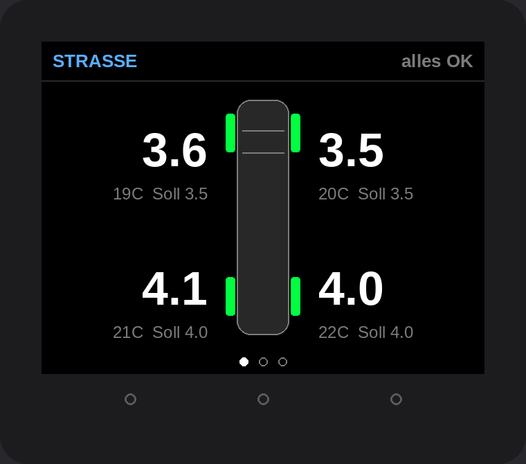
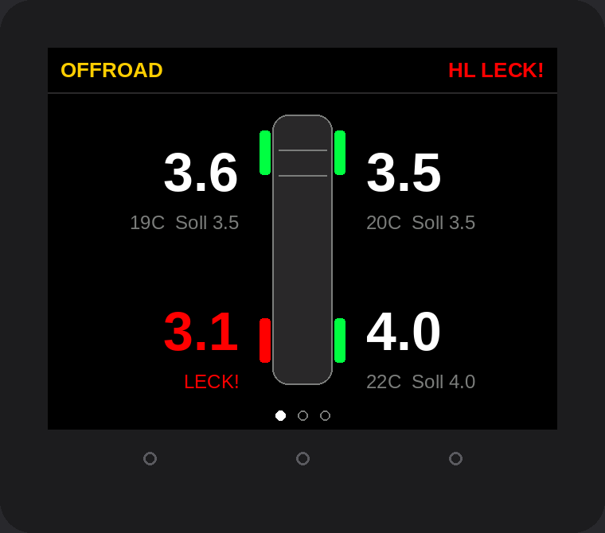

# Reifendruck- und Neigungsanzeige für den Sprinter W906

Ein schlichtes, rechteckiges Display fürs Armaturenbrett auf Basis des **M5Stack Core2**
(54 × 54 mm, 2"-Touchdisplay, alles eingebaut): Reifendruck aller 4 Räder, Umschaltung
**Straße/Offroad** mit eigenen Solldrücken, Warnungen bei Druckverlust – dazu **Neigungsmesser**
fürs Gelände und **Ausricht-Hilfe** für den Stellplatz.

- 🛒 **Was kaufen & wie einbauen?** → [TEILELISTE.md](TEILELISTE.md)

 

*(Vorschau nachgezeichnet – Positionen und Farben wie in der Firmware, Schrift angenähert.)*

## Die drei Seiten

| REIFEN | NEIGUNG | AUSRICHTEN |
|---|---|---|
| Transporter von oben, an jeder Ecke Druck, Temperatur und Soll. Oben rechts der wichtigste Status. | Heck- und Seitenansicht kippen live mit, Gradzahl, Warnung ab einstellbarem Winkel. | Libelle + **wie viele cm** unter welches Rad müssen (Auffahrkeile), bis der Camper eben steht. |

## So funktioniert's

```
 4× BLE-Ventilkappen-Sensor ──Bluetooth──►  M5Stack Core2 (Lagesensor eingebaut)
                                              │
                       Zündungsplus ── USB-Adapter ──┘ (USB-C)
```

Die Sensoren senden Druck, Temperatur und Batterie per Bluetooth; das Display hört passiv mit
(keine Kopplung per App nötig). **Sechs verbreitete Sensor-Typen** werden automatisch erkannt.

## Software aufspielen

1. [VS Code](https://code.visualstudio.com/) + Erweiterung **PlatformIO** installieren, diesen Ordner öffnen.
2. Core2 per USB-C anschließen, unten **Upload** (→) – bzw. `pio run -e m5core2 -t upload`
   (CoreS3: `pio run -e m5cores3 -t upload`).
3. Ohne Sensoren testen: Menü → **Demo-Modus an** (simuliert Druckverlust hinten links und Schaukeln).

## Bedienung (Touch)

| Wo | Aktion | Wirkung |
|---|---|---|
| Anzeige | **links / rechts tippen** oder wischen | vorige / nächste Seite |
| | **Mitte tippen** | Straße ⇄ Offroad (bei aktivem Alarm: quittieren) |
| | **lange halten** | Menü |
| Menü | Eintrag antippen | ändern (Ein/Aus-Punkte schalten direkt um) |
| | Leiste unten | hoch · zurück · runter |
| Wert ändern | Leiste unten | − · OK · + |

Beim Core2 gehen statt Touch auch die drei Tastenpunkte unter dem Display (links/Mitte/rechts,
Mitte lange halten = Menü).

**Menü:** Solldruck Straße vorn/hinten, Offroad vorn/hinten · Warn-, Kritisch-, Überdruck-Schwelle ·
Leck-Erkennung · Sensoren anlernen · Neigung nullen · Einbaulage · Warnwinkel Seite/Längs ·
Radstand/Spurweite · Helligkeit · Lautstärke · Warnton · Demo.

> ⚠️ Die Solldrücke ab Werk (Straße 3,5/4,0 bar, Offroad 2,5/2,8 bar) sind **Platzhalter**.
> Trag die Werte aus der Reifendrucktabelle deines Sprinters ein (Tankklappe/B-Säule).

### Erste Einrichtung
1. **Sensoren anlernen:** Menü → *Sensoren anlernen*. Nacheinander VL, VR, HL, HR: Sensor auf das
   angezeigte Rad schrauben (er sendet sofort), kurz drücken = übernehmen.
2. **Neigung nullen:** Sprinter auf eine ebene Fläche stellen → Menü → *Neigung nullen* → kurz drücken.
3. **Richtung prüfen:** Mit den Vorderrädern auf eine Bordsteinkante fahren – die Seite NEIGUNG muss
   „bergauf“ zeigen. Zeigt sie „bergab“ oder Seitenneigung, im Menü die *Einbaulage* um 90°-Schritte
   ändern, bis es stimmt.
4. **Radstand** eintragen (W906: 325 / 367 / 432 cm) – wichtig für die cm-Angaben beim Ausrichten.

## Warnlogik

| Zustand | Bedingung (Standard) | Anzeige | Ton |
|---|---|---|---|
| OK | im Sollbereich | weiß | – |
| HOCH | > 20 % über Soll | orange | – (z. B. nach Umschalten auf Offroad = „noch Luft ablassen“) |
| NIEDRIG | > 10 % unter Soll | orange blinkend | 2 Pieptöne, einmalig |
| KRITISCH | > 20 % unter Soll | rot blinkend | Dauer-Alarm bis Quittierung |
| LECK! | ≥ 0,3 bar Verlust in 5 min | rot blinkend | Dauer-Alarm; bleibt, bis Soll wieder erreicht |
| Neigung | ≥ 25° seitlich / 30° längs | rot | Warnton, springt auf Seite NEIGUNG |

- Schwellen gelten relativ zum Soll des **aktuellen Modus**; 0,05 bar Hysterese gegen Flackern.
- Ein quittierter Alarm meldet sich erneut, wenn es **schlimmer** wird.
- Reifen werden warm – „HOCH“ nach langer Autobahnfahrt ist normal. Solldruck kalt einstellen.
- Der Neigungsmesser ist gefiltert (ca. 1 s). Beim Bremsen/Kurvenfahren zeigt jeder
  Beschleunigungssensor kurz falsche Werte – aussagekräftig ist er langsam im Gelände und im Stand.

## Hinweise

- **Werks-RDK:** Hat dein Sprinter ab Werk Reifendruckkontrolle, sind dessen 433-MHz-Sensoren hiermit
  **nicht** lesbar. Die Ventilkappen-Sensoren funktionieren unabhängig davon zusätzlich.
- **Ventilkappen-Sensoren** mit Kontermuttern sichern. Fürs Luftablassen abschrauben, danach wieder drauf.
- **Hitze:** Nicht in die pralle Sonne hinter die Windschutzscheibe – der Core2 hat einen kleinen Akku eingebaut.

## Fehlersuche

- Sensor wird nicht gefunden: `#define DEBUG_BLE 1` oben in `include/BleTpms.h` bzw. als Build-Flag,
  dann `pio device monitor` – zeigt alle Bluetooth-Daten in der Nähe.
- „Kein Lagesensor“ (nur CoreS3 SE oder ältere Geräte): Unit IMU in **Port A** stecken, neu starten.

## Projektstruktur

```
platformio.ini            Build-Konfiguration (m5core2, m5cores3, esp32c3/esp32dev = Selbstbau-Variante, native = Tests)
src/core/main.cpp         Firmware für M5Stack Core2 / CoreS3
src/oled/main.cpp         Alternative Selbstbau-Firmware: ESP32-C3 + 1,3"-OLED + Drehgeber (siehe docs/SELBSTBAU_OLED.md)
include/BleTpms.h         Bluetooth-Empfang (gemeinsam)
lib/TpmsCore/             Logik ohne Hardware: Sensor-Dekoder, Warnungen, Neigung, Ausrichten
test/test_core/           Unit-Tests: pio test -e native
```

## Haftung

Bastelprojekt, kein zugelassenes Sicherheitssystem. Ersetzt nicht die regelmäßige Kontrolle mit
einem geeichten Manometer.
