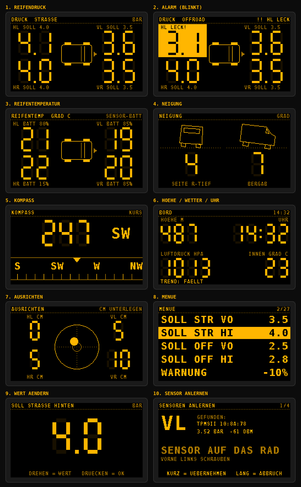

# Teileliste – Reifendruck- und Neigungsanzeige

Stand: November 2026. Preise schwanken je nach Händler – vor dem Kauf vergleichen.

## Das Display: M5Stack DinMeter v1.1

Ein Einbau-Messgerät im **1/32-DIN-Normmaß** – wie ein kleines Zusatzinstrument: vorne ein
schmaler Rahmen (**53 × 30 mm**), dahinter verschwindet das Gerät in einem rechteckigen Ausschnitt
von **45 × 22,5 mm** (32 mm Einbautiefe). 1,14"-Farbdisplay (240 × 135), Drehknopf mit Taster,
Summer, Bluetooth – und **6–36 V Eingang**: direkt ans Bordnetz, kein USB-Adapter nötig.

## Einkaufsliste

| # | Teil | Wofür | Worauf achten | ca. Preis |
|---|---|---|---|---|
| 1 | **M5Stack DinMeter v1.1** (Artikel K134-V11) | das komplette Gerät | v1.1 mit StampS3A ist die aktuelle Version. | 25–35 € |
| 2 | **4× BLE-Ventilkappen-Reifensensoren** | Druck + Temperatur je Rad | Muss eine der Apps unten nutzen. **Messbereich mind. 6 bar (87 psi)** – der Sprinter fährt hinten über 4 bar. Mit Kontermuttern. | 25–45 € |
| 3 | **Stromanschluss** | an Zündungsplus | Sicherungsabgriff („Add-A-Fuse“, Sicherungstyp im Sprinter vorher nachschauen), **2-A-Sicherung**, ca. 2 m Kabel 2 × 0,5 mm², Ringöse für Masse. Anschlussklemme am DinMeter prüfen (Doku/Lieferumfang). | 10 € |
| 4 | **M5Stack Unit Mini IMU-Pro** (BMI270 + BMM150 + BMP280, Artikel U171) – *sehr empfohlen* | Neigung, Ausrichten, **Kompass**, **Höhe, Luftdruck/Wetter, Innentemperatur** | Wird per beiliegendem Kabel in **Port A** gesteckt, kein Löten. Ohne sie laufen Reifendruck, Reifentemperatur und Uhr ganz normal. | 7–10 € |
| 5 | **Träger-Blende** | worin das Display sitzt | z. B. eine **1-DIN-Blindblende** (Radioschacht-Blende) für einen freien DIN-Schacht, oder eine Blindabdeckung/Fachabdeckung. Kostet wenig – geht beim Ausschnitt was schief, einfach neu kaufen. | 5–15 € |

**Gesamt: ca. 65–115 €.**

## Einbau

1. **Ort wählen:** z. B. freier DIN-Schacht, Blindabdeckung in der Schalterleiste oder eine Fachabdeckung.
   Hinter der Blende müssen **ca. 35 mm Tiefe** plus Platz für die Kabel frei sein.
2. **Ausschnitt 45 × 22,5 mm** anzeichnen, mit kleinem Bohrer vorbohren, mit Cutter/Feile auf Maß bringen.
   Der Rahmen vorne deckt kleine Ungenauigkeiten ab. Lieber erst etwas zu klein, dann nachfeilen.
3. Gerät von vorne einsetzen und mit den **Schraublöchern** oder **doppelseitigem Klebeband** fixieren
   (beides sieht der Hersteller vor).
4. Strom von Zündungsplus über die 2-A-Sicherung an den 6–36-V-Eingang, Masse an einen Massepunkt.
5. Die **Unit Mini IMU-Pro** fest hinter die Verkleidung kleben – sie muss starr sitzen.
   Für den Kompass möglichst **weg von Lautsprechern, Motoren und dicken Stromkabeln** (Magnetfelder).
6. Danach im Menü: Sensoren anlernen, Neigung nullen (siehe README).

> ⚠️ **Temperatur:** M5Stack gibt als Betriebstemperatur **0–40 °C** an. Im Auto wird es im Sommer
> wärmer und im Winter kälter. Deshalb einen Platz **ohne direkte Sonne** wählen (nicht oben auf dem
> Armaturenbrett, eher unten in der Mittelkonsole oder im DIN-Schacht). Einen Akku brauchst du nicht
> (es gibt nur einen optionalen Anschluss dafür). Bei Kälte kann das Display träge reagieren.

## Welche Reifensensoren?

Die Firmware erkennt automatisch diese Bauarten (Formate aus dem Open-Source-Projekt [tpms_ble](https://github.com/bkbilly/tpms_ble)):

| Typ | Erkennbar an |
|---|---|
| A | App **„TPMSII“**, Bluetooth-Name `TPMS1_…`–`TPMS4_…` – sehr verbreitet, meist günstigste Wahl |
| B | App **„SYTPMS“** |
| D | App **„ITPMS (K)“** / „LYTPMS“, Marke WODHMIEY |
| F | „HRTPMS“ |
| G | App **„Ai TPMS“** (AI-8000), Name `AI-…` |
| H | „TC.TPMS“ |

In der Produktbeschreibung steht, **welche Handy-App** man nutzen soll – ist es eine davon, passt der Sensor.
Unbekannter Typ? `DEBUG_BLE 1` setzen und das Log schicken, dann lässt sich ein Dekoder ergänzen.
