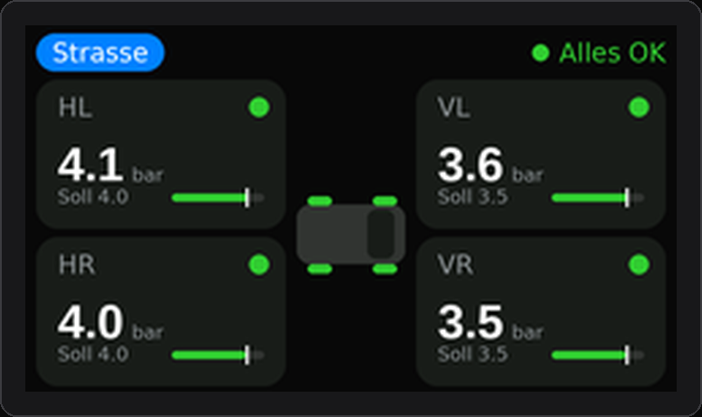
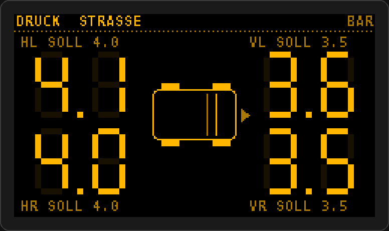

# Teileliste – Reifendruck- und Neigungsanzeige

Stand: November 2026. Preise schwanken je nach Händler – vor dem Kauf vergleichen.

## Das Display: M5Stack DinMeter v1.1

Ein Einbau-Messgerät im **1/32-DIN-Normmaß** – wie ein kleines Zusatzinstrument: vorne ein
schmaler Rahmen (**53 × 30 mm**), dahinter verschwindet das Gerät in einem rechteckigen Ausschnitt
von **45 × 22,5 mm** (32 mm Einbautiefe). 1,14"-Farbdisplay (240 × 135), Drehknopf mit Taster,
Summer, Bluetooth – und **6–36 V Eingang**: direkt ans Bordnetz, kein USB-Adapter nötig.

 

## Einkaufsliste (vollständig)

### Bestellung 1: alles aus dem M5Stack-Shop (shop.m5stack.com)

| ✓ | Menge | Teil | Artikel | Wofür | ca. Preis |
|---|---|---|---|---|---|
| ☐ | 1 | **DinMeter v1.1** | K134-V11 | das Display. **Im Lieferumfang:** Anschlussklemme (2-polig, 2,54 mm) für 6–36 V, Halteklammer, Klebeband | 25–35 $ |
| ☐ | 1 | **9-DoF IMU Unit** (BMI270 + BMM350) | U229 | Neigung, Ausrichten **und Kompass** | ca. 15 $ |
| ☐ | 1 | **Barometric Pressure Unit** (QMP6988) | U090-B | Höhe, Luftdruck/Wetter, Innentemperatur | ca. 5 $ |
| ☐ | 1 | **1-zu-3 HUB Unit** (Grove-Verteiler) | U006 | beide Units an Port A des DinMeter | ca. 3,50 $ |
| ☐ | 1 | **Grove-Kabel 20 cm** (Packung) | „Grove Cable 20cm“ | Verbindung DinMeter → HUB → Units (meist liegt je Unit ein Kabel bei – eine Reserve schadet nicht) | 2–3 $ |
| ☐ | 1 | USB-C-Kabel (Daten) | | Firmware aufspielen – nur falls keins zu Hause | 2–3 $ |

**Zwischensumme M5Stack: ca. 50–65 $** (+ Versand/Zoll aus China einplanen)

**Falls etwas ausverkauft ist** – die Firmware erkennt auch:
- statt 9-DoF IMU: **6-Axis IMU Unit (MPU6886, U095)** → Neigung + Ausrichten, aber **ohne Kompass**
- statt 9-DoF IMU + Barometer + HUB: **Unit Mini IMU-Pro (U171)** → alles in einem Modul
- statt Barometric Pressure Unit: **ENV III (QMP6988)** oder **ENV IV (BMP280)**

### Alternative zu Bestellung 1: alles bei BerryBase (Versand aus Deutschland)

| ✓ | Menge | Teil | Artikel | Wofür | ca. Preis |
|---|---|---|---|---|---|
| ☐ | 1 | **M5DinMeter** | M5-K134 (bzw. v1.1: K134-V11) | das Display. Die erste Version hat eine DC-Buchse statt Klemme – beide laufen mit der Firmware | – |
| ☐ | 1 | **6-Axis IMU Unit (MPU6886)** | M5-U095 | Neigung + Ausrichten (kein Kompass) | 8,90 € |
| ☐ | 1 | **ENV III Unit** (SHT30 + QMP6988) | M5-U001-C | Höhe, Luftdruck/Wetter, Innentemperatur | 7,90 € |
| ☐ | 1 | **HUB Expansion Unit, 3 × Grove** | M5-U006 | IMU + ENV III gemeinsam an Port A | 4,40 € |
| ☐ | 1 | Grove-Kabel 20 cm | | IMU liegt nur ein 5-cm-Kabel bei | 2–3 € |

Einen **Kompass** führt BerryBase als M5-Unit derzeit nicht – den kann man später mit der
Mini IMU-Pro (U171) oder der 9-DoF IMU (U229) aus dem M5Stack-Shop nachrüsten.

### Bestellung 2: Reifensensoren (Amazon)

| ✓ | Menge | Teil | Hinweis | ca. Preis |
|---|---|---|---|---|
| ☐ | 1 Set (4 Stück) | **WODHMIEY Reifendruck-Kontrollsystem** (ASIN B0GWH88YSV) | App „ITPMS (K)“ → Format Typ D, wird erkannt. **Messbereich prüfen** (über deinem Solldruck hinten) | 30–45 € |

### Bestellung 3: Baumarkt / Autozubehör

| ✓ | Menge | Teil | Hinweis | ca. Preis |
|---|---|---|---|---|
| ☐ | 1 | **Sicherungsabgriff („Add-A-Fuse“)** | Bauform: vorher eine Sicherung im Sprinter ziehen und vergleichen (Mini oder Low-Profile-Mini) | 3–5 € |
| ☐ | 1 | **Flachsicherung 2 A** (gleiche Bauform) | | 1 € |
| ☐ | 2 m | **Fahrzeugleitung 0,5 mm²**, rot + schwarz | Plus und Masse | 3 € |
| ☐ | 1 | **Ringkabelschuh M6**, isoliert | Masse an Karosserieschraube | 1 € |
| ☐ | 4 | **Stoßverbinder** + Schrumpfschlauch | | 3 € |
| ☐ | 1 | **1-DIN-Blindblende** oder Blind-/Fachabdeckung | darin der Ausschnitt 45 × 22,5 mm | 5–15 € |
| ☐ | 1 | **3M VHB**-Klebeband (schmal) | für die Sensor-Units hinter der Verkleidung (das Klebeband beim DinMeter reicht fürs Display) | 5 € |
| ☐ | 1 | Gummitülle, ein paar Kabelbinder | | 2 € |

**Gesamt: ca. 110–150 €** inkl. Versand.

### Werkzeug

Multimeter (Zündungsplus-Sicherung finden), Abisolierzange, Crimpzange, Verkleidungskeile,
Cutter + kleine Feile + Bohrer (Ausschnitt), Isopropanol zum Entfetten, PC mit VS Code + PlatformIO.

## Einbau

1. **Ort wählen:** z. B. freier DIN-Schacht, Blindabdeckung in der Schalterleiste oder eine Fachabdeckung.
   Hinter der Blende müssen **ca. 35 mm Tiefe** plus Platz für die Kabel frei sein.
2. **Ausschnitt 45 × 22,5 mm** anzeichnen, mit kleinem Bohrer vorbohren, mit Cutter/Feile auf Maß bringen.
   Der Rahmen vorne deckt kleine Ungenauigkeiten ab. Lieber erst etwas zu klein, dann nachfeilen.
3. Gerät von vorne einsetzen und mit den **Schraublöchern** oder **doppelseitigem Klebeband** fixieren
   (beides sieht der Hersteller vor).
4. Strom von Zündungsplus über die 2-A-Sicherung an den 6–36-V-Eingang, Masse an einen Massepunkt.
5. Die **Unit Mini IMU-Pro** fest hinter die Verkleidung kleben – sie muss starr sitzen.
   Für den Kompass möglichst **weg von Lautsprechern, Motoren und dicken Stromkabeln** (Magnetfelder).
6. Danach im Menü: Sensoren anlernen, Neigung nullen (siehe README).

> ⚠️ **Temperatur:** M5Stack gibt als Betriebstemperatur **0–40 °C** an. Im Auto wird es im Sommer
> wärmer und im Winter kälter. Deshalb einen Platz **ohne direkte Sonne** wählen (nicht oben auf dem
> Armaturenbrett, eher unten in der Mittelkonsole oder im DIN-Schacht). Einen Akku brauchst du nicht
> (es gibt nur einen optionalen Anschluss dafür). Bei Kälte kann das Display träge reagieren.

## Konkrete Empfehlung Reifensensoren

| Wahl | Produkt | App | Format | Warum | Achtung |
|---|---|---|---|---|---|
| **1** | z. B. **WISTEK 4-Sensor TPMS** (Amazon, ASIN B09Z2P6M48) oder baugleiche „Bluetooth TPMS 4 externe Sensoren“ | **TPMSII** | Typ A | verbreitetstes Format, Dekoder mit echtem Mitschnitt getestet | Messbereich laut Anleitung **bis 6,4 bar (92,6 psi)** – reicht, wenn dein Solldruck hinten ≤ ca. 5,5 bar ist |
| 2 | **WODHMIEY Reifendruck-Kontrollsystem** (Amazon.de, ASIN B0GWH88YSV) | ITPMS (K) / LYTPMS | Typ D | im Referenzprojekt mit echtem Mitschnitt belegt, auf Amazon.de verfügbar | Messbereich vor dem Kauf auf der Produktseite prüfen |
| 3 | AliExpress-Sets laut Referenzprojekt: [TPMSII](https://www.aliexpress.com/item/1005006129840804.html), [SYTPMS](https://www.aliexpress.com/item/1005006755884183.html) | TPMSII / SYTPMS | Typ A / B | günstig | lange Lieferzeit; bei 4-Sensor-Variante bestellen, nicht Motorrad (2 Sensoren) |

**Wichtig:** Händler verkaufen äußerlich gleiche Sensoren mit unterschiedlicher Elektronik. Entscheidend ist
die **App in der Beschreibung**. Nach dem Auspacken mit der App testen – und wenn das Display sie nicht
findet: `DEBUG_BLE 1` setzen und das Log schicken, dann ergänze ich den Dekoder. Bei Amazon ist die
Rücksendung einfacher als bei AliExpress.

Markensets mit eigener App (z. B. SuperSense, Maxsensor, FOBO) funken mit eigenen Protokollen und
werden **nicht** erkannt.

## Welche Reifensensoren?

Die Firmware erkennt automatisch diese Bauarten (Formate aus dem Open-Source-Projekt [tpms_ble](https://github.com/bkbilly/tpms_ble)):

| Typ | Erkennbar an |
|---|---|
| A | App **„TPMSII“**, Bluetooth-Name `TPMS1_…`–`TPMS4_…` – sehr verbreitet, meist günstigste Wahl |
| B | App **„SYTPMS“** |
| D | App **„ITPMS (K)“** / „LYTPMS“, Marke WODHMIEY |
| F | „HRTPMS“ |
| G | App **„Ai TPMS“** (AI-8000), Name `AI-…` |
| H | „TC.TPMS“ |

In der Produktbeschreibung steht, **welche Handy-App** man nutzen soll – ist es eine davon, passt der Sensor.
Unbekannter Typ? `DEBUG_BLE 1` setzen und das Log schicken, dann lässt sich ein Dekoder ergänzen.
