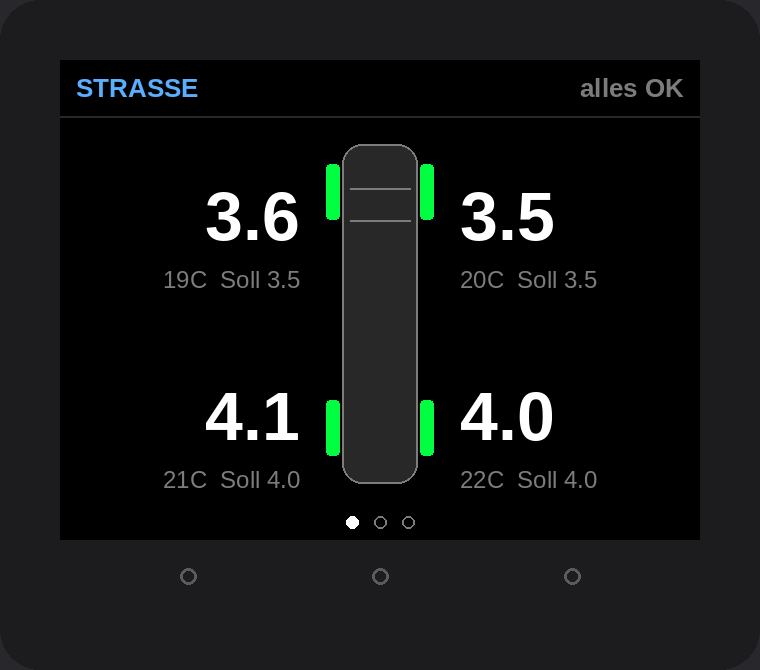

# Teileliste – Reifendruck- und Neigungsanzeige

Stand: November 2026. Preise schwanken je nach Händler – vor dem Kauf vergleichen.

## Das Display: M5Stack Core2

Ein fertiges, schlichtes Kästchen: **54 × 54 × 16 mm**, 2"-Farbdisplay (320 × 240) mit Touch,
Lautsprecher, Bluetooth und **eingebautem Lagesensor** für die Neigungsanzeige. Kein Löten,
kein Gehäusebau. Unter dem Display liegen drei Touch-Tastenpunkte.

## Einkaufsliste

| # | Teil | Wofür | Worauf achten | ca. Preis |
|---|---|---|---|---|
| 1 | **M5Stack Core2** (v1.1 oder Nachfolger v1.3) | das komplette Gerät | v1.1 wird teils abverkauft, v1.3 hat einen anderen Lagesensor – beide werden von der Firmware erkannt. | 45–55 € |
| 2 | **4× BLE-Ventilkappen-Reifensensoren** | Druck + Temperatur je Rad | Muss eine der Apps unten nutzen. **Messbereich mind. 6 bar (87 psi)** – der Sprinter fährt hinten über 4 bar. Mit Kontermuttern. | 25–45 € |
| 3 | **USB-Ladeadapter fürs Auto**, fest verbaut (12 V → USB-C, z. B. Einbau-USB-Buchse) **oder** Kfz-USB-Stecker | Strom | Auf **Zündungsplus** anschließen, damit das Display mit der Zündung ausgeht. Für Festeinbau: Sicherungsabgriff („Add-A-Fuse“, Sicherungstyp im Sprinter vorher nachschauen) + 2-A-Sicherung. | 10–20 € |
| 4 | **USB-C-Kabel, 90° gewinkelt**, 0,5–1 m | Kabel verschwindet seitlich | Winkelstecker, damit es flach anliegt. | 5–8 € |
| 5 | **3M Dual Lock** (Druckverschluss-Klettband) oder **3M VHB**-Klebepad | Befestigung | Dual Lock hält bombenfest und das Gerät lässt sich trotzdem abnehmen (zum Flashen oder gegen Diebstahl). Fläche mit Isopropanol entfetten. | 5–10 € |

**Gesamt: ca. 90–130 €.**

### Alternative: M5Stack CoreS3
Gleiche Größe, schnellerer Chip, ebenfalls mit Lagesensor (Firmware-Variante `m5cores3`). Etwas teurer.
Die günstige **CoreS3 SE** hat **keinen** Lagesensor – dann zusätzlich die **M5Stack Unit IMU** (ca. 8 €)
in Port A stecken. Ohne Neigungsanzeige reicht die SE so wie sie ist.

## Einbau

1. Platz wählen: oben auf dem Armaturenbrett, an der Mittelkonsole oder neben dem Radio.
   **Nicht in die pralle Sonne hinter der Scheibe** – der Core2 hat einen kleinen Akku eingebaut,
   der Hitze über 60 °C nicht mag. Ein schattiger Platz unterhalb der Scheibenkante ist ideal.
2. Fläche entfetten, Dual Lock auf Gerät und Armaturenbrett, zusammendrücken.
3. USB-Kabel seitlich hinter der Verkleidung zur USB-Buchse/zum Adapter führen.
4. Der Lagesensor ist im Gerät – **es muss fest sitzen** (nicht in einer wackeligen Handyhalterung),
   sonst zeigt die Neigung Unsinn.
5. Danach im Menü: Sensoren anlernen, Neigung nullen (siehe README).

## Welche Reifensensoren?

Die Firmware erkennt automatisch diese Bauarten (Formate aus dem Open-Source-Projekt [tpms_ble](https://github.com/bkbilly/tpms_ble)):

| Typ | Erkennbar an |
|---|---|
| A | App **„TPMSII“**, Bluetooth-Name `TPMS1_…`–`TPMS4_…` – sehr verbreitet, meist günstigste Wahl |
| B | App **„SYTPMS“** |
| D | App **„ITPMS (K)“** / „LYTPMS“, Marke WODHMIEY |
| F | „HRTPMS“ |
| G | App **„Ai TPMS“** (AI-8000), Name `AI-…` |
| H | „TC.TPMS“ |

In der Produktbeschreibung steht, **welche Handy-App** man nutzen soll – ist es eine davon, passt der Sensor.
Unbekannter Typ? `DEBUG_BLE 1` setzen und das Log schicken, dann lässt sich ein Dekoder ergänzen.
