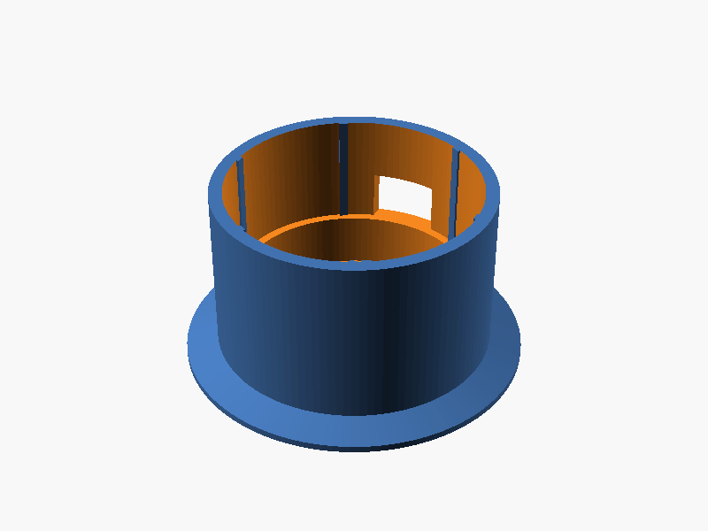
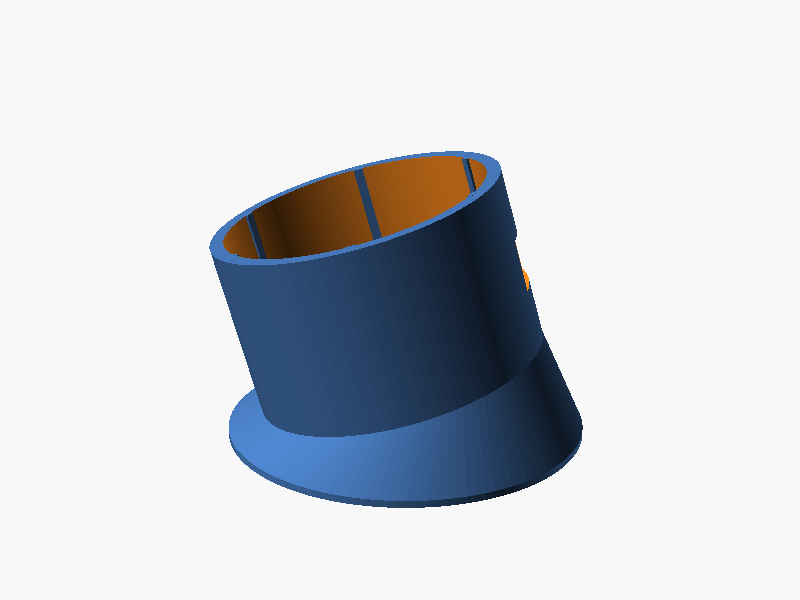
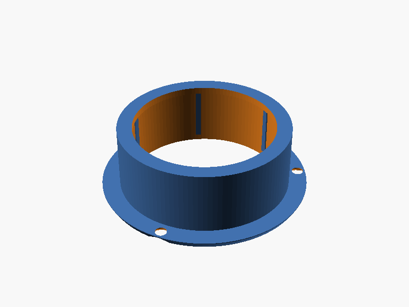

# Halter für den M5Stack Dial

Zwei Einbauarten. Beide halten nur das **Unterteil** des Dial – der Drehring oben bleibt frei.
Die Teile sind parametrisch (`m5dial_halter.scad`, kostenlos mit [OpenSCAD](https://openscad.org) zu öffnen);
fertige STL-Dateien liegen in `stl/`.

| Datei | Was | Druckzeit ca. |
|---|---|---|
| `stl/testring.stl` | **Zuerst drucken!** 6 mm hoher Ring zum Prüfen der Passung | 10 min |
| `stl/aufbau.stl` | Aufbau-Halter zum Aufkleben, Kabel nach unten | 1,5 h |
| `stl/aufbau_15grad.stl` | dasselbe, 15° zum Fahrer geneigt | 2 h |
| `stl/einbau.stl` | Einbau-Blende für ein rundes Loch in einer Verkleidung | 1,5 h |
| `stl/schablone.stl` | Bohr-/Anreißschablone für das Einbauloch | 10 min |

## Variante A – Aufbau (aufkleben)

 

- Becher mit Klemmrippen; der Dial wird einfach hineingedrückt.
- Unter dem Dial sind **10 mm Kabelraum** für die Grove-Stecker und das Stromkabel. Die kleine
  **Unit IMU** (Neigungssensor) passt mit hinein – mit einem Stück doppelseitigem Klebeband fixieren.
- Im Boden ein **Ø 14 mm Loch**: genau darunter ein Loch ins Armaturenbrett bohren, Kabel nach innen.
  Kein Loch gewünscht? `kabel_seitlich = true` → Kabelauslass seitlich am Fuß.
- Seitlicher **Schlitz für USB-C**, um ohne Ausbau neue Firmware aufzuspielen.
- Fuß Ø 62 mm für ein **3M-VHB-Klebepad**. Fläche mit Isopropanol reinigen, 30 s fest andrücken,
  24 h aushärten lassen, bevor das Gewicht drankommt.

## Variante B – Einbau (bündig)



- Flansch vorne (sichtbar), Tubus geht durch ein **rundes Loch von 50,4 mm** (bei Standardmaßen;
  OpenSCAD gibt den genauen Wert in der Konsole aus).
- Mit 3 Senkkopfschrauben 2,9 mm oder Kleber befestigen; Dial von vorne hineindrücken.
- Hinter der Verkleidung braucht es ca. **25 mm Tiefe** plus Platz für die Kabel.
- Loch mit `schablone.stl` anzeichnen, dann Lochsäge/Stufenbohrer, mit Feile nacharbeiten.
- Tipp: In eine **Blindabdeckung** oder einen Fachdeckel einbauen statt ins Armaturenbrett selbst.

## Vor dem Druck: nachmessen!

Die Maße des Dial stammen aus dem Datenblatt (Ø 45 × 32,3 mm). Miss mit dem Messschieber nach und
trag die Werte oben in `m5dial_halter.scad` ein:

| Parameter | Bedeutung | Standard |
|---|---|---|
| `dial_d` | Durchmesser des Gehäuse-**Unterteils** | 45,0 |
| `dial_h` | Gesamthöhe | 32,3 |
| `ring_frei` | Höhe von oben, die frei bleiben muss (Drehring + 1–2 mm Luft) | 12 |
| `spiel` | Luft rundum | 0,30 |
| `quetschrippen` | Klemmung der 6 Rippen | 0,45 |
| `neigung` | Neigung des Aufbau-Halters in Grad | 0 |

Dann den **Testring** drucken: Der Dial soll sich mit leichtem Druck hineinschieben lassen und von
allein halten. Zu stramm → `spiel` +0,1; zu locker → `quetschrippen` +0,15. Außerdem prüfen, wo die
USB-Buchse sitzt (die Kerbe im Testring zeigt die Lage des USB-Schlitzes).

## Druckeinstellungen

- **Material: ASA oder ABS** (am besten), **PETG** geht auch. **Kein PLA** – im Sommer wird es im Auto
  heißer als 60 °C, PLA verformt sich.
- 0,2 mm Schichthöhe, 3 Perimeter, 25 % Infill, keine Stützen nötig.
- Aufbau-Halter mit dem Fuß nach unten, Einbau-Blende mit dem Flansch nach unten (so liegen sie in den Dateien).
- Optik: Mattschwarz passt zum Sprinter-Innenraum; sichtbare Fläche liegt auf dem Druckbett = glatt.

## STL neu erzeugen

```bash
openscad -o stl/aufbau.stl -D 'teil="aufbau"' -D 'neigung=10' m5dial_halter.scad
```
